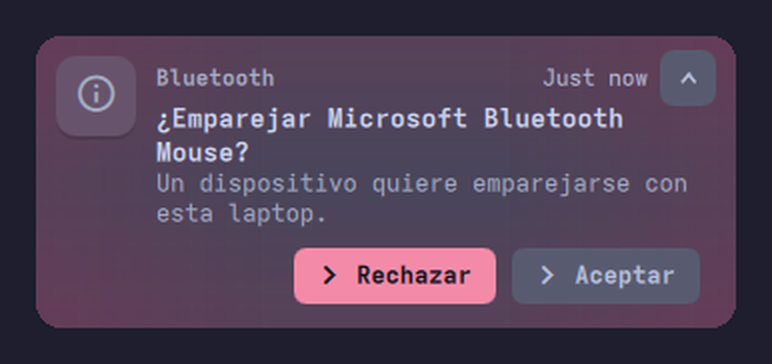
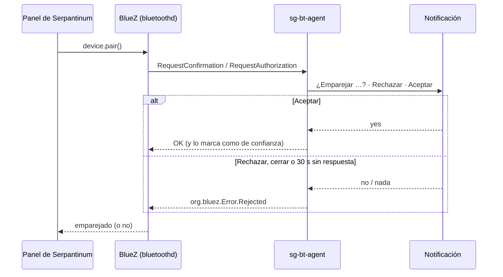

# sg-bt-agent


**Empareja dispositivos Bluetooth desde el panel de [Serpantinum](https://github.com/ilyamiro/serpantinum),
sin abrir la terminal.** Cuando un dispositivo pide emparejarse, aparece una notificación:



> **English:** a tiny BlueZ pairing agent (Python + D-Bus) that asks through a desktop notification
> with *Reject / Accept* buttons. Made for Serpantinum (Hyprland + Quickshell), whose Bluetooth panel
> can pair devices but ships no agent, so BlueZ refuses with `No agent available`. Never accepts on
> its own: no answer in 30 s, or a closed notification, means *reject*. It also finishes the job the
> panel skips: right after pairing a speaker, headset, mouse or keyboard, it asks BlueZ to `Connect()`
> (Quickshell refuses because the pairing link already reports `Connected`). AGPL-3.0-or-later.

## El problema
El panel de Bluetooth de Serpantinum busca y conecta dispositivos, pero **no registra un agente de BlueZ**:
el programa que responde *"¿aceptas emparejar este dispositivo?"*. Sin agente, BlueZ rechaza el
emparejamiento de los dispositivos nuevos:

```text
bluetoothd: src/device.c:new_auth() No agent available for request type 2
bluetoothd: device_confirm_passkey: Operation not permitted
```

Con `sg-bt-agent`, el mismo intento termina en la notificación de arriba. Los dispositivos ya
emparejados se siguen conectando directo desde el panel:


### Segundo problema: emparejado, pero sin sonido
Al terminar de emparejar, el panel llama a `device.connect()`. Pero en ese momento BlueZ todavía marca
el dispositivo como `Connected`, porque sigue abierto el enlace que usó para emparejar, y Quickshell
se niega a pedir la conexión:

```text
ERROR quickshell.bluetooth.device: Device BluetoothDevice(… dev_XX_XX_…) is already connected
```

El enlace se cae a los pocos segundos y queda `Paired: yes`, `Connected: no`: un parlante emparejado
que no suena. `sg-bt-agent` lo completa: 2 s después de emparejar un **parlante, audífonos, mouse o
teclado** (`Icon` = `audio-*` o `input-*`), le pide `Connect()` a BlueZ directamente. Si el panel ya lo
conectó, BlueZ responde `AlreadyConnected` y no pasa nada.

## Cómo funciona


## Seguridad
- **Nunca acepta solo.** Sin respuesta en 30 s, o si cierras la notificación → rechaza.
- `Rechazar` es la **primera** acción: en Serpantinum, un clic en el cuerpo de la notificación ejecuta
  la primera acción, así que un clic accidental **rechaza**.
- Capacidad `DisplayYesNo`: puede mostrar un código y preguntar sí/no. No acepta PIN escritos:
  esos casos se rechazan con un aviso (usar `bluetoothctl`).
- El nombre del dispositivo se limpia (solo caracteres imprimibles, máximo 64) antes de mostrarlo.
- Al aceptar, marca el dispositivo como de confianza (`Trusted`) para que se reconecte solo.
- Si BlueZ se reinicia, el agente se vuelve a registrar.
- Conectar después de emparejar: solo con señales de BlueZ (no de otros programas), solo si BlueZ
  confirma `Paired`, y solo con parlantes, audífonos, mouse y teclados. Celulares y laptops no se
  conectan solos.

## Requisitos
- `python3`, `python3-dbus` (dbus-python) y `python3-gobject` (GLib).
- `notify-send` con `--action` (libnotify 0.7.10 o más nuevo) y un servidor de notificaciones con
  botones: el de Serpantinum (Quickshell), mako, dunst, swaync…
- BlueZ 5.

En Fedora: `sudo dnf install python3-dbus python3-gobject libnotify`.

## Instalación
```bash
install -Dm755 sg-bt-agent ~/.local/bin/sg-bt-agent
install -Dm644 sg-bt-agent.service ~/.config/systemd/user/sg-bt-agent.service
systemctl --user daemon-reload && systemctl --user enable --now sg-bt-agent.service
journalctl --user -u sg-bt-agent | tail -1   # → agente registrado (DisplayYesNo) y como predeterminado
```
> ⚠️ El servicio se activa con `hyprland-session.target`, un *target* de usuario que arranca al iniciar
> Hyprland (`BindsTo=graphical-session.target`). Si no lo tienes, cambia `WantedBy=` por el *target*
> de tu sesión. **No lo actives en GNOME ni KDE:** ya traen su propio agente, y dos agentes compiten
> por ser el predeterminado.

**Para probarlo:** desvincula un dispositivo desde el panel y vuelve a emparejarlo. Si el emparejamiento
lo inicias tú y el dispositivo no tiene pantalla ni teclado (un mouse, por ejemplo), BlueZ puede
emparejar directo sin preguntar (*Just Works*). La notificación aparece cuando el **dispositivo** pide
emparejarse o cuando hay un código que confirmar (celulares, laptops).

## Pruebas
`bash tests/test-sg-bt-agent.sh` (unos 45 s). **No tocan tu Bluetooth:** levantan un D-Bus privado con
un BlueZ falso y reemplazan `notify-send` por un script que responde solo. Son 13 casos: se registra,
aceptar (y marcar como de confianza), rechazar, cerrar la notificación, un PIN, la cancelación de BlueZ,
un nombre con caracteres de control, BlueZ reiniciado, el tiempo límite de 30 s y, después de
emparejar: conecta un parlante (esperando 2 s), no conecta un celular, no reacciona a otros cambios
y no le hace caso a una señal falsa de otro programa. Cada caso nuevo se comprobó con un agente
"mutante" (con ese error a propósito): la prueba lo detecta.

## Licencia
Copyright (C) 2026 Ekzzzzzz.

Este programa es software libre: puedes redistribuirlo y modificarlo bajo los términos de la
**GNU Affero General Public License** publicada por la Free Software Foundation, versión 3 o
(a tu elección) cualquier versión posterior. Ver [`LICENSE`](LICENSE).
